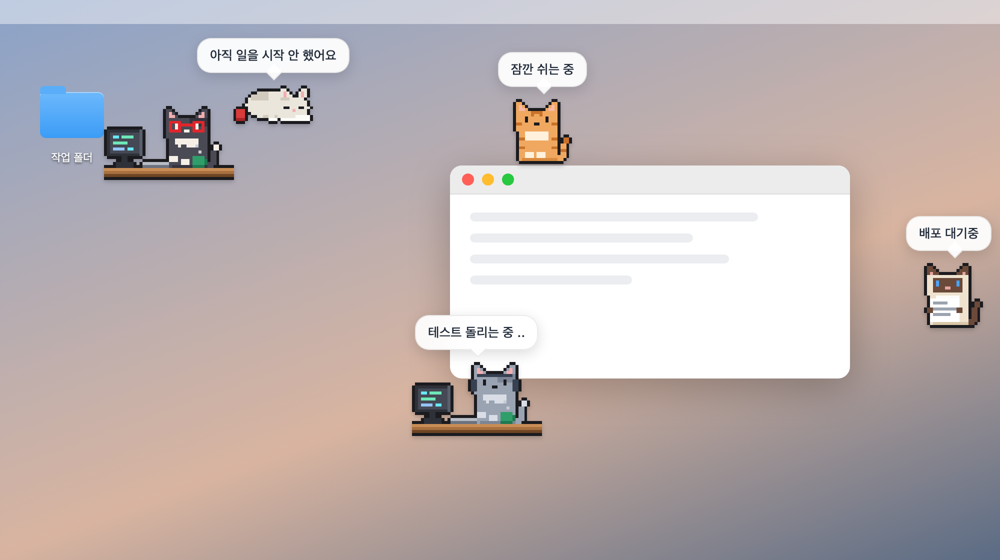

# 고양이 팀

Claude Code 세션 하나를 도트 고양이 한 마리로 보여주는 macOS 데스크톱 펫입니다. 🐈

- 일하는 중이면 모니터 앞에서 타닥타닥 치고, 쉬는 중이면 데스크톱을 돌아다니다 몸을 말고 잡니다.
- 말풍선으로 그 세션이 지금 무슨 일을 하는지 알려줍니다.



## 준비물

- macOS 14 이상
- Command Line Tools (`python3`, `swiftc`). 없으면 `xcode-select --install` 로 설치하세요.

> 참고: 이 Mac 에서 연 Claude Code 세션만 보입니다.

## 바로 써보기: 데스크톱 앱

```bash
git clone https://github.com/wad-woojeongmin/agent-cats.git
cd agent-cats
bash desktop/build.sh
open 고양이팀.app
```

1. 처음 켜면 `팀.example.json` 을 복사해 `팀.json` 을 만듭니다.
2. `팀.json` 의 `match` 를 내 프로젝트 폴더 이름이나 세션 제목에 들어갈 말로 바꿉니다. 메뉴 막대 고양이 아이콘 → 팀원 관리에서 바꿔도 됩니다.

고양이가 움직이기 시작하면 성공입니다. 클릭하거나 끌어서 옮겨보세요!

### 다른 방법: 브라우저 화면

```bash
python3 수집.py --loop
```

수집기를 켜 둔 채로 `index.html` 을 열면 됩니다.

## 고양이 설정: 팀.json

`cats` 목록에 고양이 하나당 한 줄을 씁니다.

| 항목 | 뜻 |
| --- | --- |
| `key` | 겹치지 않는 영문 이름 |
| `match` | 찾을 말 목록. 세션 제목이나 작업 폴더 경로에 하나라도 들어 있으면 이 고양이 담당입니다 |
| `name`, `role` | 이름과 직군 |
| `variant` | 품종: `white`, `tabby`, `gray`, `tux`, `siamese` |
| `prop` | 소품: `headphones`, `glasses`, `postit`, `chart`, `paper` |
| `task` | (선택) 일하는 중에 말풍선에 띄울 업무명 |
| `fixed` | (선택) 세션과 상관없이 띄울 고정 상태. 예: `{"main": "배포 대기중"}` |
| `private` | (선택) true 면 말풍선에 보고 문장과 폴더·파일 이름을 싣지 않습니다 |

> 참고: `팀.json` 은 내 컴퓨터에만 두는 설정이라 git 에 올라가지 않습니다.

## 조작

- **클릭**: 자세한 말풍선
- **드래그**: 옮기기. 창 윗변이나 메뉴 막대 근처에 놓으면 그 위에 앉습니다.
- **우클릭**: 고정, 다른 디스플레이로 보내기, 숨기기, 팀원 관리 열기
- **메뉴 막대 고양이 아이콘**: 팀원 관리, 행동 설정, 투명도·크기 등 기타 설정

디스플레이가 여러 개면 고양이를 나눠 띄웁니다.

## 자주 막히는 곳

- 고양이가 모두 "아직 일을 시작 안 했어요"로 잔다: `match` 에 적은 말이 폴더 경로나 세션 제목에 실제로 있는지 확인하세요.
- "고양이 팀 폴더를 찾지 못했어요"가 뜬다: `고양이팀.app` 을 프로젝트 폴더 밖으로 옮기지 마세요.
- "파일/폴더와 놀기"가 안 된다: 시스템 설정 → 개인정보 보호 및 보안 → 자동화에서 고양이팀의 Finder 를 켜세요.

## 테스트

```bash
node tests/sim.js
swiftc -swift-version 5 -parse-as-library desktop/DisplayAssign.swift tests/assign_test.swift -o /tmp/assign_test && /tmp/assign_test
```
